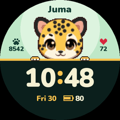
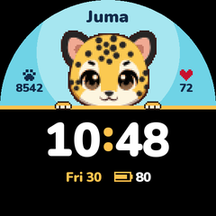

# Juma

A cute jaguar cub peeking over a ledge above the time.

| Pantanal | Sakura | Jungle | Sky |
|---|---|---|---|
|  |  |  |  |

Download a face from [tbwf/](tbwf), then follow the [install steps](../../README.md#install-a-face).

## Build it

From the repository root, this rebuilds every palette:

```bash
python -m faces.juma.build
```

Name a palette to build one:

```bash
python -m faces.juma.build pantanal
```

Add a palette to `PALETTES` in [build.py](build.py). The tests check its contrast and that nothing
overlaps or gets clipped by the round screen.

[How it was made](how-it-was-made.md) tells the whole story.
